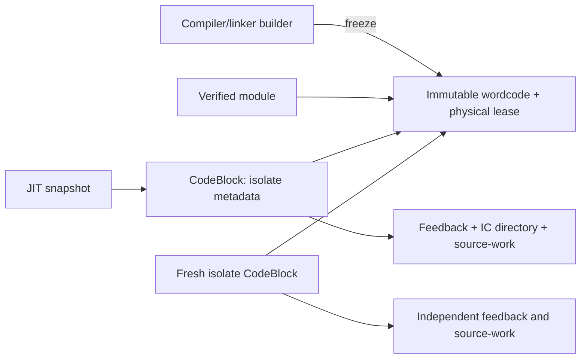

# Архитектурный аудит Otter и план крупных рефакторов

> Состояние артефактов, 22 октября 2026, около 20:15 UTC: во время текущих проверок исчезли созданные в этой сессии каталоги `benchmarks/results/*2026-10-21*` и `*2026-10-22*`, включая raw A/B, patches и сохранённые baseline executables. Причина не установлена; команды этого чата удаляли только Cargo build caches. Числа ниже остаются исторически наблюдёнными результатами, но соответствующие старые raw-ссылки сейчас недоступны и не являются воспроизводимым набором доказательств. Исходники и Git-коммиты целы. Новые records/executables сохраняются в `/Users/alexanderstreltsov/.codex/artifacts/otter-2026-10-22/`; baseline текущего среза требуется пересобрать из коммита, а адресные gates повторить для восстановления записей.

## Текущий план по конкретным механизмам V8 и JavaScriptCore

Исходники доступны локально и проверены на точных ревизиях: V8 `926c0e5fb9cd60257e49cbdf7855ba42dd13963c`, WebKit/JSC `e9c03b26665d2a3f4c9002075d90f9d9d5c1cb5e`. Ниже указаны действительные механизмы и границы переноса. Полный перенос чужого коллектора или оптимизатора не требуется.

| Граница | Что действительно делает другой движок | Разница Otter и действие |
|---|---|---|
| Ссылки установленного native code | V8 сохраняет обязательные relocations фактически выпущенного кода; deopt literals формируются отдельно из translation operands | Otter сохранял весь prepared root set, включая отвергнутых inline-кандидатов. Реализован mandatory cell-use proof из emission плюс владельцы finalized dependency metadata; один `CompilationRoot` owner после установки |
| Фоновая компиляция | V8 удаляет queued jobs и передаёт активным atomic cancellation flag; compiler проверяет его между фазами; source handles живут до завершения job | Реализован общий worker-visible token, terminal cancellation, удержание исходных chunks до ACK и проверка фактически spliced sources перед publication |
| Жизнь неактивного optimizing code | JSC делает связь Executable → optimizing CodeBlock условной; speculative references слабы, активный/marked CodeBlock удерживает их сильно | Используемые константы Otter пока сильны весь срок generation. Это отдельный будущий code-GC срез; обнулить ссылки без retirement/active-frame протокола нельзя |

### 1. Установленный код получает свои реальные ссылки

В V8 `MacroAssembler::Cmp` регистрирует embedded object при выпуске инструкции; `CodeBuilder` принимает `CodeDesc`, переносит relocations в `InstructionStream`, а GC обходит этот обязательный список. Это runtime metadata, существующее без diagnostic capture. Отдельный deopt literal table строится из translation operands и дедуплицируется: перечень machine references не заменяет recovery metadata. [Эмиссия](https://github.com/v8/v8/blob/926c0e5fb9cd60257e49cbdf7855ba42dd13963c/src/codegen/x64/macro-assembler-x64.cc#L3235), [перенос relocations](https://github.com/v8/v8/blob/926c0e5fb9cd60257e49cbdf7855ba42dd13963c/src/objects/instruction-stream-inl.h#L134), [GC обход](https://github.com/v8/v8/blob/926c0e5fb9cd60257e49cbdf7855ba42dd13963c/src/objects/objects-body-descriptors-inl.h#L1757), [deopt literals](https://github.com/v8/v8/blob/926c0e5fb9cd60257e49cbdf7855ba42dd13963c/src/compiler/backend/code-generator.cc#L1259).

Otter воспроизводит конкретный дефект владения: `cold` вызывается один раз и захватывает массив из 1 048 576 элементов; `hot` получает настоящий Graph OSR. Sloppy `cold` наблюдает `this`, поэтому plain-call с `undefined` не допускает splice. Events подтверждают prepared candidate, artifacts — отсутствие actual inline и отсутствие отдельного native body `cold`. После возврата и двух GC payload case удерживает **9 656 416 Б**, контроль с восемью элементами **1 136 808 Б**. Разница **8 519 608 Б** принадлежит подготовленным, но не использованным владельцам. Сырые source/events/artifacts: `benchmarks/results/root-use-2026-10-22/before-v2-*`. Первый строгий вариант repro действительно inlined callee и потому не доказывал дефект; его данные сохранены отдельно и не используются как доказательство unused owner.

Исправление завершает одну границу producer → consumer: оба native emitter регистрируют фактические stable-cell references независимо от `--jit-artifacts`; Graph добавляет strong context owners, необходимые finalized `ClosureContext` dependencies даже после устранения context load; `JitCompileStatus::Compiled` переносит sorted unique `required_cells`; VM при публикации фильтрует только `CalleeIdentity` roots. Pending compilation сохраняет весь подготовленный набор до terminal result. Shape/family/prototype/instanceof ownership этим срезом не меняется. В установленном code object второй reference registry не появляется. Проверки должны доказать освобождение unused payload и сохранность действительно используемых native constants через moving GC на обеих ISA.

### Измеренный результат pruning установленных roots

Baseline `857a9cdb7`, SHA256 `0a4e85804f81e7e33169b66fc14cfde725424aad810a05b9d11d084e6a73f4c7`; after SHA256 `1a33806f2e343a534078f4040823e8ff7c4915397b38595834c48a60b7a44d21`. After включает также отдельный COW bounds fix `26dbe8ae2`. Оба executable собраны отдельно с одинаковой default production конфигурацией. Rust builds/profiler не работали во время измерений; host snapshots сохранены. Три чередующиеся AB/BA-пары после одной исключённой warmup-пары на каждом классе; все 64 процесса завершились с одинаковыми результатами. CPU — median суммы user+sys каждого процесса, включая worker threads.

| Класс | Wall median, с до → после | Δ wall | CPU median, с до → после | Peak RSS median, МиБ до → после |
|---|---:|---:|---:|---:|
| crypto | 0.2042 → 0.2049 | +0.34% | 0.21 → 0.21 | 43.80 → 43.41 |
| deltablue | 0.6555 → 0.6588 | +0.50% | 0.68 → 0.67 | 60.38 → 61.33 |
| box2d | 0.6119 → 0.6314 | +3.17% | 0.70 → 0.74 | 132.66 → 135.03 |
| raytrace | 0.8139 → 0.8523 | +4.72% | 0.82 → 0.84 | 46.77 → 47.20 |
| splay | 0.6371 → 0.6584 | +3.34% | 1.18 → 1.20 | 381.12 → 381.02 |
| regexp | 1.3544 → 1.3840 | +2.18% | 1.34 → 1.35 | 140.52 → 141.05 |
| mandreel | 0.9995 → 1.0098 | +1.03% | 1.06 → 1.06 | 224.12 → 223.61 |
| ts | 3.0864 → 3.0626 | -0.77% | 4.13 → 4.11 | 495.64 → 501.52 |

| Класс | Wall min…max до / после, с | Peak RSS min…max до / после, МиБ |
|---|---:|---:|
| crypto | 0.204…0.206 / 0.205…0.205 | 43.391…44.766 / 42.719…45.688 |
| deltablue | 0.649…0.665 / 0.639…0.659 | 57.797…60.906 / 60.172…62.422 |
| box2d | 0.611…0.629 / 0.616…0.651 | 132.656…136.859 / 130.797…136.828 |
| raytrace | 0.807…0.903 / 0.832…0.853 | 46.406…47.422 / 45.781…47.359 |
| splay | 0.637…0.643 / 0.634…0.669 | 380.828…385.547 / 376.688…383.375 |
| regexp | 1.334…1.358 / 1.322…2.087 | 139.359…140.969 / 139.516…141.078 |
| mandreel | 0.996…1.018 / 1.004…1.012 | 219.500…226.625 / 218.641…225.078 |
| ts | 3.065…3.095 / 3.040…3.089 | 488.906…500.656 / 500.516…501.766 |

Общего ускорения нет: TS wall −0,77%/CPU 4,13 → 4,11 с, но остальные medians wall выше на 0,34…4,72%; Box2D CPU 0,70 → 0,74 с. Это результат владения памятью, не достигнутая цель speed+resources. В двух зафиксированных hot-code артефактах до/после codeBytes совпадают (Template 5400, Graph 2536); инструкциям не приписывается speedup.

Три адресные post-GC пары: payload heap **9 656 416 → 1 136 584 Б (−88,23%)**, control **1 136 808 → 1 136 584 Б**; все три значения внутри каждого набора совпали. Payload RSS median **34,50 → 26,30 МиБ**. Actual `hot` получил Graph OSR, `cold` не имеет собственного native body и не был spliced; наличие prepared candidate и отсутствие `inlineLowered` сохранены в `native-use-proof.json`. Старый production executable падает на новой retention assertion; interpreter и новый executable проходят.

На прежнем неизменённом require-wrapper полного TS три новые пары дали heap до **7,885…48,800 МиБ**, после **7,885…7,885 МиБ**; post-GC RSS median **301,53 → 300,89 МиБ**. Эти три прогона не доказывают отсутствие остаточного скачка во всех расписаниях background compiler. Wrapper retention не смешивается с plain-fixture peak RSS в таблице выше.

Адресные gates: mandatory sorted use proof и metadata-only accepted contexts, actual cell emission с выключенным artifact capture — по 4 JIT unit tests на ISA; existing VM owner filter 2; actual native context/closure — по 2 на ISA; shared Tagged growth moving-GC fixture — по 2 на ISA. CLI driver: 32 успешных процесса и один ожидаемый baseline failure, включая interpreter oracle / production / jitless / interpreter для двух новых corpus и existing unique-context, затронутые GC strides 1/4/16, retention и actual artifacts; ещё шесть TS retention процессов. Release ENOSPC исправлен удалением только пересоздаваемых debug incremental caches; failed build log сохранён, тесты не перезапускались.

Все команды, точный compiled-source patch, source/binary hashes, build failure/retry, диапазоны и сырые stdout/time: `benchmarks/results/root-use-2026-10-22/`.

### 2. Worker должен прекращать ненужную работу

Это готовая модель V8, а не предложение убивать потоки. Dispatcher `FlushJobsForIsolate` удаляет queued jobs; `CancelCompilationJobsForIsolate` вызывает `job->Cancel` у активных jobs; atomic flag проверяется до graph и после каждой compiler phase. Teardown сначала flush/cancel, затем ждёт jobs и их LocalHeap destruction, затем освобождает output без установки. [Queued/active lifecycle](https://github.com/v8/v8/blob/926c0e5fb9cd60257e49cbdf7855ba42dd13963c/src/compiler-dispatcher/optimizing-compile-dispatcher.cc#L247), [проверка между фазами](https://github.com/v8/v8/blob/926c0e5fb9cd60257e49cbdf7855ba42dd13963c/src/compiler/pipeline.cc#L839), [удержание source](https://github.com/v8/v8/blob/926c0e5fb9cd60257e49cbdf7855ba42dd13963c/src/codegen/optimized-compilation-info.h#L312).

Перед publication V8 дополнительно проверяет detached context, disabled optimization, deprecated maps и dependency validity; commit повторяет validation непосредственно перед installation. Otter уже проверяет dependencies при install — это существующее совпадение. Добавленные границы: worker-visible cancellation и source lifetime при eviction (`Arc<CodeBlock>` не является lease на независимо evictable `ChunkPayload`). [Dependency commit](https://github.com/v8/v8/blob/926c0e5fb9cd60257e49cbdf7855ba42dd13963c/src/compiler/compilation-dependencies.cc#L1461).

Реализация: один monotonic atomic token Pending/Job/Request; queued cancellation удаляет request из FIFO, уничтожает snapshot вне mutex и публикует ACK без вызова compiler hook. Active compiler проверяет token до/после analysis, plan, Graph construction, отдельных optimization passes, register allocation, target emission и final metadata/artifact output. Текущая фаза может завершиться целиком: millisecond deadline и остановка внутри builder/regalloc не обещаются. Проверки до/после hook и перед publication также отклоняют поздний ответ стороннего hook, игнорирующего token. Отмена имеет terminal `cancelled`, не `Unsupported`; queued skip имеет `compileStartedNs: null` и duration=0. Compile attempts учитывают фактически вошедшие hooks.

Pending сохраняет `CompilationSources` с физическими `ExecutionContext` owners всех подготовленных plain/mono/poly/direct-method bodies до terminal ACK. Isolate-side owner не передаётся worker. Final admission независимо проверяет root CodeBlock/CodeSpace и owners фактически spliced functions. Pressure census сначала отменяет requests и освобождает готовые ACK; ещё активный job удерживает chunk, затем его ACK повторно разрешает обычную проверку pressure watermark. ACK сам не запускает GC. Teardown отменяет и присоединяет worker threads до освобождения heap/shape runtime и pending owners.

Первый production прототип выявил реальную регрессию: source traversal пропустил четвёртую ветвь `direct_methods[*].body`. Artifact с таким фактическим splice отвергался; ошибочная фильтрация compile-attempt counter оставляла бюджет немедленно готовым к следующей компиляции. DeltaBlue warmup вырос **0,6956 → 167,1174 с**; следующий процесс остановлен после sample. Матрица имеет явный `aborted-performance-regression` и не используется как итоговый A/B. Исправлены обе границы: source closure включает direct methods, а текущий root с неверным splice получает обычный `installDeclined: invalidCode`, учитывает попытку и кэширует отказ на том же feedback. Только dead/foreign root становится cancellation, без воскрешения per-function состояния. Новый regression проверяет отсутствие повторного hook после invalid splice.

Короткие gates: пять VM/JIT unit tests по cancellation (включая существующий host-job case), source lease test с пятью независимыми chunks и foreign CodeSpace с совпадающими ids, queued/active ACK ownership и ignored-token publication refusal; actual native optimizing OSR source-work regression; 32 успешных CLI процесса с production/jitless/interpreter oracle, GC strides 1/4/16, retained-root control/payload и actual Graph artifacts. ISA encoders этим срезом не менялись. Два пропущенных test caller аргумента найдены первым cold build и исправлены; failure log сохранён.

Полная доля wasted compilation в workload CPU **ещё не измерена**. Подготовленный embedded `compile-waste-2026-10-22/drop_tail.rs` не дал сравнимых до/после данных: первый link отказал из-за LTO, затем по запросу пользователя выполнен `cargo clean` (70 204 файлов, 28,1 GiB). Сумма compiler wall durations не называется CPU хвоста. Сохранённые production executables и сырые результаты clean не затронул.

Финальный default production CLI собран после ремонта, SHA256 `4884daf5e04dd5358efde5b6ebaa7f0e97adc94a3a183cd72ee3395a1eb9650e`; baseline предыдущего среза `1a33806f2e343a534078f4040823e8ff7c4915397b38595834c48a60b7a44d21`. Три AB/BA-пары плюс исключённая warmup-пара на каждом из восьми классов завершили все 64 процесса с одинаковыми результатами. Однако в середине матрицы началась **внешняя сборка `server-rs`**, зафиксированная в `regexp-0..3-processes.txt` (Cargo, затем несколько rustc около 80–99% CPU). Наши builds/profiler во время A/B не запускались. Эта матрица помечена `performanceInterpretation: contaminated-external-build`; она не доказывает ни ускорение, ни отсутствие регрессии. Ниже сохранены наблюдения, без принятия их за performance score.

| Класс | Wall median, с до → после | CPU median, с до → после | Peak RSS median, МиБ до → после |
|---|---:|---:|---:|
| crypto | 0.2176 → 0.2326 | 0.22 → 0.25 | 43.11 → 44.14 |
| deltablue | 0.7550 → 0.6602 | 0.74 → 0.69 | 61.36 → 61.34 |
| box2d | 0.6511 → 0.6587 | 0.74 → 0.74 | 132.28 → 133.86 |
| raytrace | 0.9163 → 0.9861 | 0.90 → 0.90 | 46.92 → 46.72 |
| splay | 0.7295 → 0.6903 | 1.23 → 1.20 | 365.95 → 366.80 |
| regexp | 1.8271 → 2.6008 | 1.74 → 2.25 | 139.52 → 140.11 |
| mandreel | 1.3604 → 1.0464 | 1.40 → 1.10 | 224.08 → 221.88 |
| ts | 3.6456 → 3.9092 | 4.70 → 5.10 | 496.78 → 495.64 |

Все min/max каждого wall/CPU/RSS и исходные per-process counters находятся в `repair/whole-ab/summary-cpu.json` и `results.json`. В частности regexp wall до 1,686…2,724 с / после 2,558…2,890 с; executed instructions практически совпадают (18,56…18,62 / 18,61…18,70 млрд), чего недостаточно для вывода об одинаковой скорости на ненагруженном host.

После окончания внешней сборки выполнена новая полная матрица `repair/whole-ab-repeat/`: ещё 64 процесса, три измеряемые пары на класс, hashes неизменны, outputs совпадают; snapshots не содержат Cargo/rustc. Обычная UI/system нагрузка host остаётся. Crypto wall 0,2546 → 0,2276 с при CPU 0,23 → 0,24; DeltaBlue 0,6486 → 0,6456 / CPU 0,67 → 0,67; Box2D 0,6085 → 0,6190 / 0,69 → 0,70; RayTrace 0,8403 → 0,9012 / 0,83 → 0,89; Splay 0,6201 → 0,6289 / 1,06 → 1,09; RegExp 1,3210 → 1,3582 / 1,34 → 1,34; Mandreel 0,9896 → 1,0103 / 1,05 → 1,06; TS 3,1809 → 3,3166 / 4,22 → 4,34. Полные RSS/instructions/min/max находятся в новом `summary-cpu.json`. **Общего ускорения нет**; этот срез завершает cancellation/source-lifetime границу, а цель speed+resources остаётся открытой.

Ещё три чередующиеся пары неизменённого TS post-GC wrapper: live JS heap до **7,884781…7,884811 МиБ**, после **7,884811…7,884964 МиБ**; RSS median **299,44 → 305,34 МиБ**, диапазоны 287,11…302,09 / 301,61…305,73 МиБ. Это не выигрыш памяти, а проверка отсутствия прежнего крупного retained JS payload на этих расписаниях. Wrapper не заменяет plain fixture peak RSS.

Первый дефектный executable, прерванная матрица, sample compile storm, repaired source patch, hashes, cold build failures, команды и сырые gates: `benchmarks/results/compile-cancellation-2026-10-22/`; исправленный финальный набор — `repair/`.

### Текущий срез: один владелец подготовленного method target

До этого рефактора `jit_compile.rs` передавал `direct_methods[*].body.clone()` в legacy method baking; `jit_inline_methods.rs` повторно сохранял тот же Arc в mono **или** poly таблице. Graph читал direct carrier, Template — legacy carrier. Затем `jit_field_types.rs` вызывал `Arc::make_mut` отдельно для обеих ветвей: sharing превращался в две owned snapshot copies на overlap edge, включая instruction overlays и вложенные maps. Цепочка трёх таких edges допускала восемь leaf copies и 14 descendant snapshots вместо трёх различных descendants. Inline bytecode budget оплачивал `bake_inline_body`, но не эти copy-on-write copies. Это статически доказанный механизм; прежние events показывают присутствие обеих групп на DeltaBlue, но не позволяют честно вычислить runtime bytes или процент CPU.

Реализована одна таблица guarded method targets, один body на `(site, target)`, optional direct call plan и optional Template leaf field proof. Удалены три прежние карты и два carrier types, producer и оба tier consumers переведены одновременно. Field/context/source scans проходят одно дерево. Template leaf planning теперь читает snapshot напрямую: прежний полный clone с последующим clear target maps не нужен, поскольку plan builder их не использует. Target без call plan необходим: Template умеет inline body при отсутствии entry generation; Graph сохраняет требование call capability. Глобальная дедупликация только по function id неверна, поскольку guards и context constants относятся к конкретному target. Chain indices сохраняют исходную позицию до capability filtering на обеих ISA.

Budget policy теперь одна: Graph-capable method body готовится один раз с фактической site frequency; отказ больше не повторяется вторым frequency-free leaf request. Template-only body сохраняет прежнюю leaf admission. Это намеренное изменение admission, требующее полного A/B, а не обещание идентичного выбора всех inline candidates.

Реальный VM producer regression создаёт verified root → три nested methods, живые shaped descriptors/PIC и опубликованные entry cells. Он наблюдает 3/6 уникальных body owners для mono/poly случая; каждый Arc имеет strong count=1. После `bake_field_type_tree` адреса Arc и instruction buffers совпадают, реальный leaf field bound заполнен; budget расходуется ровно по одному разу на body. Одинаковый function id на двух receiver shapes сохраняет отдельные targets/field locations. Native unit regressions проверяют отсутствие Graph admission у Template-only target и исходные индексы после его пропуска. Дополнительный JS corpus проверяет разные captured contexts одного method source, prototype replacement, method getter и own-field accessor; старый production и interpreter дают одинаковый результат, поэтому существовавшее runtime-падение ему не приписывается.

Основной ожидаемый эффект — compile CPU и temporary snapshot peak; steady-state heap или ускорение полного исполнения заранее не заявляются. Сырые gates, отдельные ENOSPC/stale-fixture failures и будущий финальный A/B: `benchmarks/results/method-targets-2026-10-22/`. Устаревшие exact artifact assertions (5 registers/5 opcodes) проверены сохранённым baseline CLI: он уже выдавал 4 registers/4 opcodes и slots `[0,1,0,null]`; тест обновлён к этой действующей форме, без ослабления range/ownership checks.

### 3. JSC: weak code dependencies и активный стек

JSC — более широкий механизм, чем текущий Otter cell pruning. `Graph::freeze` по умолчанию создаёт `WeakValue`; `handleGetScope` специализирует function scope через `weakJSConstant`. При linking `registerFrozenValues` обходит **все** frozen values, а не только emitted uses: weak values переходят в `DesiredWeakReferences`, strong — в CodeBlock constants. Поэтому приписывать JSC наш точный emitted-use алгоритм было бы неправильно. [Scope constant](https://github.com/WebKit/WebKit/blob/e9c03b26665d2a3f4c9002075d90f9d9d5c1cb5e/Source/JavaScriptCore/dfg/DFGByteCodeParser.cpp#L7707), [registerFrozenValues](https://github.com/WebKit/WebKit/blob/e9c03b26665d2a3f4c9002075d90f9d9d5c1cb5e/Source/JavaScriptCore/dfg/DFGGraph.cpp#L1664).

Пока compilation жива, эти references трассируются сильно. Finalize формирует фиксированные vectors; `reallyAdd` переносит их в CommonData. Неактивный optimizing CodeBlock становится live только после доказательства независимой достижимости всех weak dependencies. Уже marked/active CodeBlock, наоборот, strongly visits weak references. [Pending roots](https://github.com/WebKit/WebKit/blob/e9c03b26665d2a3f4c9002075d90f9d9d5c1cb5e/Source/JavaScriptCore/dfg/DFGPlan.cpp#L656), [публикация](https://github.com/WebKit/WebKit/blob/e9c03b26665d2a3f4c9002075d90f9d9d5c1cb5e/Source/JavaScriptCore/dfg/DFGDesiredWeakReferences.cpp#L71), [условная code edge](https://github.com/WebKit/WebKit/blob/e9c03b26665d2a3f4c9002075d90f9d9d5c1cb5e/Source/JavaScriptCore/runtime/ScriptExecutable.cpp#L558), [liveness](https://github.com/WebKit/WebKit/blob/e9c03b26665d2a3f4c9002075d90f9d9d5c1cb5e/Source/JavaScriptCore/bytecode/CodeBlock.cpp#L1484), [active references](https://github.com/WebKit/WebKit/blob/e9c03b26665d2a3f4c9002075d90f9d9d5c1cb5e/Source/JavaScriptCore/bytecode/CodeBlock.cpp#L2028).

Для Otter это означает будущую единую фазу code liveness + entry retirement + active-frame roots при GC, а не превращение всех `LoadCellValue` в слабые ссылки. Остаточный TS шаг 41 МиБ пока не приписан этому владельцу: нужны observations конкретных generations/roots.

### Отвергнутый Array execution срез

Полная попытка заменить arbitrary-JS miss у Graph ArrayPush/Pop на no-JS probes, включая actual `CallWithThis`, обе ISA, COW copy-out и раздельные semantic/OOM exits, удалена из активного кода. Семантические/native/GC проверки проходили; artifacts показывали сохранение чужих field facts (4 loads → 1). Однако финальные три AB/BA-пары на восьми неизменённых классах не дали общего ускорения: DeltaBlue **+21,37% wall** (CPU 0,72 → 0,77 с), Box2D **+11,20%** (0,73 → 0,79 с), TS **+1,49%** (4,24 → 4,26 с). Это не принятый performance result. Все 64 процесса дали одинаковые результаты. Полные диапазоны/CPU/RSS, binary/source SHA, неудачные проверки и rejected patch: `benchmarks/results/array-cow-probes-2026-10-22/`.

Отдельно сохраняется найденное исправление корректности: shared tagged slab сообщает writable capacity=0, но хранит полный prefix. Прежний inline grow выделял `max(2*capacity,4)` и мог копировать восемь элементов в четыре слота. Обе ISA теперь резервируют `max(2*capacity,4,length+1)` до копирования. Этот fix не объявляется ускорением и не сохраняет отвергнутый no-JS refactor.

## Цель и критерий

Цель — конкурентная скорость полного исполнения, прогретого исполнения, startup и компиляции при минимальных peak RSS и удерживаемой памяти. Лидерство над другими движками должно подтверждаться на опубликованной матрице, а не одним TS-прогоном или снижением числа инструкций. Превосходство над всеми движками на любых программах не является проверяемым обещанием.

Работа идёт в текущем checkout. Все исходные изменения сохранены одним checkpoint-коммитом `fa4cc6668`. Последующий field-observer эксперимент не принят как достижение цели: сокращение emitted code около 17% дало только 2,7% медианного выигрыша полного ts, без убедительного уменьшения RSS. Его executable, patch и пять пар сохранены в `benchmarks/results/metadata-ownership-2026-10-21/compact-experiment/`. Observer-прототип полностью удалён из активного кода; его последний patch сохранён в `benchmarks/results/architecture-census-2026-10-22/rejected-observer.patch`.

## Законченный срез: наблюдения JIT перестают владеть JS graph

Baseline этого среза — `4c8dff094`, executable `shared-wordcode-2026-10-22/final/after-otter`, SHA256 `eb833505405f36ea230810818d26e09a01f3d07c23231700b72fd2ff7b108dcc`. Аудит выполнялся параллельно по трём направлениям: реальные GC owners, горячий Graph и source/compiler metadata.

### Выбор по подтверждённой стоимости

| Кандидат | Подтверждённая причина / граница | Решение |
|---|---|---|
| Время жизни speculative JS observations | Возвратившийся callee с массивом 1 048 576 элементов после двух GC удерживает 9 572 840 Б heap в production против 1 052 856 Б interpreter. Отдельно первая closure context без native compilation удерживает 9 656 560 Б даже в interpreter | Выбран: устранить сильное владение из writable identity caches и first-context observation; сохранить сильные native constants |
| Object/field SSA и sinking | В самых горячих Box2D bodies сотни field reads/conversions и почти нет allocations. В DeltaBlue `chainTest` есть receivers, но реальные CallJs, context stores и loop states блокируют sinking | Следующий execution срез должен менять field/alias/loop model, а не повторять отвергнутый global Float64 boxing |
| Cold source facts | CodeBlock копирует +4 Б/op byte-PC mapping, compressed spans разворачиваются в 12-байтовые записи; lazy environment и preparse forest могут копироваться по глубине | Величина реального lazy/preparse удержания ещё не измерена. Не выбран ещё один небольшой source-only рефактор |

### Единственная модель владения

* `CompilationRoot` удерживает Rust carrier на срок pending compilation / установленного native generation. Само существование carrier не означает владения наблюдавшимся JS значением.
* Writable callee identity и пара target/prototype `instanceof` — слабые наблюдения. Живые значения переписываются после nursery movement; мёртвый callee становится EMPTY, а потеря любого члена пары очищает всю пару. Следующий native hit проходит обычную исходную proof. Новый runtime call, replay и дополнительный hit guard не добавлены.
* `ClosureContexts` владеет address-stable фактом источника, но первая наблюдённая context слаба. Смерть context навсегда переводит факт в unavailable до повторного использования cage offset: потеря первого наблюдения не разрешает считать следующий контекст первым.
* Когда compiler действительно специализирует body по этой context, он сначала публикует сильную held cell в текущей compile session. Именно её адрес получает `unique_closure_context`. Pending result и затем native generation удерживают эту context до физического retirement. Неиспользованная cell удаляется, если constants отсутствуют. Cell-values методов и context slots также остаются сильными: native `LoadCellValue` читает их без локальной проверки.
* Один `CalleeIdentityCell` carrier обслуживает оба домена; private strength bit отделяет immutable constant от writable cache. Цена — 8 дополнительных байт Rust payload на таком carrier на текущем host и отдельная held cell у реально специализируемой unique context. Это не новый registry или второй GC entry.

GC получает один `ExtraRootSource::process_weak` протокол. Nursery вызывает его после strong tracing и ephemeron fixpoint, пока forwarding headers ещё существуют, до flip и освобождения young-large. Major вызывает его непосредственно перед sweep после окончательного marking, включая публичный split incremental mark/sweep путь. Composite native scopes передают hook; повторная обработка безопасна. Resolver никогда не маркирует и не эвакуирует целевые объекты. GC plumbing хранит raw boundary, VM обновляет atomic Value words и scalar dependency flags без managed allocations или JS reentry.

Существующее условие оптимизатора «GC не ломает активные assumptions» сохранено: generation-owned context и все unguarded constants сильны. Поэтому не понадобилось ослаблять `LoadCellValue` effects, добавлять постфактум deopt после allocation или менять hit-код одной ISA в отрыве от другой. ARM64 и x86_64 используют тот же адрес сильной cell и тот же EMPTY miss у слабого cache.

### Сопоставление с исходниками других движков

[V8: weak objects in optimized code](https://github.com/v8/v8/blob/926c0e5fb9cd60257e49cbdf7855ba42dd13963c/src/objects/code-inl.h) различает weak JSReceiver/Context/PropertyCell references и обязательные materialization maps. В [major collector](https://github.com/v8/v8/blob/926c0e5fb9cd60257e49cbdf7855ba42dd13963c/src/heap/mark-compact.cc) смерть embedded target инвалидирует dependent code. Otter пока не переносит эту более широкую weak-code модель: для direct constants она требует согласованной invalidation и проверки на collecting boundaries.

[JSC CodeBlock liveness](https://github.com/WebKit/WebKit/blob/e9c03b26665d2a3f4c9002075d90f9d9d5c1cb5e/Source/JavaScriptCore/bytecode/CodeBlock.cpp) отдельно доказывает независимую достижимость weak dependencies неактивного optimized body; marked/active CodeBlock может удерживать необходимые ссылки сильными. [Pending DFG references](https://github.com/WebKit/WebKit/blob/e9c03b26665d2a3f4c9002075d90f9d9d5c1cb5e/Source/JavaScriptCore/dfg/DFGDesiredWeakReferences.cpp) трассируются сильно во время compilation. Применённое разделение observation / pending-and-installed assumption следует этой границе времени жизни, без копирования чужого collector или code liveness protocol.

### Проверка и измерения среза

Сырые данные, команды, binary/source identities и оба минимальных retention reproducer: `benchmarks/results/root-retention-2026-10-22/`.

Пять чередующихся AB/BA-пар после исключённой warmup пары, полный неизменённый fixture, отдельные процессы. Все 36 запусков завершились с одинаковым результатом. ARM64 M1 / 16 ГиБ / macOS 26.5, production opt3/thin LTO/codegen1/debug1/default features; RUSTFLAGS и CARGO_TARGET_DIR отсутствовали. Параллельных Rust builds и profiler не было; обычные фоновые host processes сохранены в snapshots. After binary SHA256 `0a4e85804f81e7e33169b66fc14cfde725424aad810a05b9d11d084e6a73f4c7`.

| Класс | Wall median, с до → после | Δ wall | CPU median, с до → после | Peak RSS median, МиБ до → после | Δ RSS |
|---|---:|---:|---:|---:|---:|
| deltablue | 0.6658 → 0.6804 | +2.19% | 0.69 → 0.71 | 60.20 → 62.77 | +4.26% |
| splay | 0.6655 → 0.6912 | +3.86% | 1.23 → 1.24 | 375.06 → 379.89 | +1.29% |
| ts | 3.2537 → 3.5745 | +9.86% | 4.49 → 4.49 | 563.22 → 500.00 | -11.22% |

| Класс | Wall min…max до / после, с | Peak RSS min…max до / после, МиБ |
|---|---:|---:|
| deltablue | 0.6517…0.6776 / 0.6621…0.7200 | 58.73…61.72 / 58.38…65.39 |
| splay | 0.6599…0.6935 / 0.6734…0.6989 | 365.31…383.88 / 373.80…383.70 |
| ts | 3.0987…4.0171 / 3.0491…4.5962 | 526.98…623.08 / 492.55…504.98 |

Три post-GC AB/BA-пары, отдельные процессы. Для TS это require-wrapper, а не plain fixture вход выше.

| Сценарий | Live heap median до → после, МиБ | Heap min…max до / после, МиБ | Post-GC RSS median до → после, МиБ |
|---|---:|---:|---:|
| callee | 9.13 → 1.00 | 9.13…9.13 / 1.00…1.00 | 36.11 → 28.06 |
| source | 9.21 → 1.08 | 9.21…9.21 / 1.08…1.08 | 32.25 → 24.22 |
| ts | 254.41 → 7.88 | 254.09…295.22 / 7.88…48.80 | 552.78 → 309.64 |

Постоянное владение JS graph из observations устранено: TS median live heap −96,90%, post-GC RSS −43,99%, обычный median peak RSS −11,23%. Это подтверждённое крупное улучшение удержания памяти. **Ускорение полного исполнения не достигнуто**: TS CPU median одинаков, wall median хуже на 9,86%, DeltaBlue/Splay medians тоже хуже. Разброс TS велик и интервалы перекрываются; ни регрессию, ни отсутствие регрессии нельзя заменять выбором самого быстрого запуска. В одной из трёх after retention пар TS сохраняет 48,80 МиБ вместо 7,88: остаточный шаг порядка 41 МиБ не объявлен локализованным или устранённым.

Проверки: GC extra-root filter 4; VM identity owners 2 и source-context 2; настоящие native context/closure cases по 2 на ARM64 и x86_64/Rosetta; x86 owner tests 2; один hot-eval eviction regression; новый JS case и existing unique-context case во всех трёх tier policies против baseline interpreter; новый case GC strides 1/4/16; семь реальных Graph bodies в artifacts. Всего diagnostic driver записал 30 успешных процессов. Форматирование проверено на изменённых Rust files; incidental baseline-only formatting из `cargo fmt --all` удалено. Полные suites/Clippy/Test262 не запускались. `compiled-source.patch`, `build-manifest.json`, `build-commands.json`, `diagnostics.json`, `whole-ab/results.json`, host/process snapshots и исходные stdout/stderr сохранены.

Проверенный затем ArrayPush/ArrayPop execution срез отвергнут по полному A/B; результаты и удалённый patch приведены выше. Текущий следующий execution срез — отмена ненужной фоновой компиляции с source lifetime до terminal ACK.

Остаточные сильные владельцы: реальные generation constants, shape → prototype graph, активные frames и pending compilation. Их удержание не объявляется исправленным этим срезом. `process.memoryUsage().external/arrayBuffers == 0` остаётся неполным API coverage, а не доказательством отсутствия внешней памяти.

## Результат законченного shared-wordcode среза

Удалён второй VM instruction/overflow массив; compiler, CodeBlock и native snapshots читают один immutable body. Одновременно удерживаемые compiler+VM instruction данные изменились с 56 до 28 байт/op, включая новую IC directory. Есть отдельная цена owner header у холодных функций. Исправлен baseline crash nested merge phi; numeric, feedback-arena и liveness прототипы в финальный код не входят.

Пять чередующихся AB/BA-пар после одной исключённой warmup пары на каждом полном неизменённом fixture. Apple M1, 16 ГиБ, macOS 26.5; оба CLI отдельно собраны `cargo build --release -p otter-cli`, default features, opt 3/thin LTO/codegen-units 1/debug 1, без RUSTFLAGS. CPU — медиана user+sys одного процесса со всеми его потоками. Source и binary SHA, команды, watchdog, stdout/stderr и process snapshots сохранены. Во всех 96 запусках, включая warmup, результаты совпали.

| Класс | Wall, с: до → после | Δ | CPU, с: до → после | Peak RSS, МиБ: до → после | Δ RSS |
|---|---:|---:|---:|---:|---:|
| crypto | 0.2074 → 0.2082 | +0.39% | 0.21 → 0.21 | 43.80 → 43.58 | -0.50% |
| deltablue | 0.6643 → 0.6548 | -1.44% | 0.69 → 0.68 | 60.55 → 59.19 | -2.25% |
| box2d | 0.6280 → 0.6274 | -0.08% | 0.72 → 0.72 | 133.25 → 133.47 | +0.16% |
| raytrace | 0.8237 → 0.8264 | +0.34% | 0.83 → 0.83 | 47.00 → 47.00 | +0.00% |
| splay | 0.6649 → 0.6573 | -1.14% | 1.22 → 1.20 | 367.36 → 376.58 | +2.51% |
| regexp | 1.3451 → 1.3243 | -1.54% | 1.36 → 1.34 | 140.39 → 139.62 | -0.55% |
| mandreel | 1.0014 → 1.0149 | +1.35% | 1.06 → 1.08 | 222.81 → 222.94 | +0.06% |
| ts | 3.3022 → 3.1547 | -4.47% | 4.34 → 4.29 | 609.08 → 572.75 | -5.96% |

Разброс пяти измеренных запусков:

| Класс | Wall до min…max, с | Wall после min…max, с | Парные Δ wall min…max |
|---|---:|---:|---:|
| crypto | 0.2064…0.2254 | 0.2068…0.2172 | -3.61…+0.89% |
| deltablue | 0.6504…0.6797 | 0.6464…0.6737 | -2.81…+1.41% |
| box2d | 0.6173…0.6458 | 0.6216…0.6359 | -2.85…+3.02% |
| raytrace | 0.7926…0.8598 | 0.7982…0.8738 | -4.88…+10.25% |
| splay | 0.6640…0.7074 | 0.6446…0.6674 | -8.88…+0.50% |
| regexp | 1.3339…1.3590 | 1.3122…1.3559 | -3.44…+1.50% |
| mandreel | 0.9991…1.0134 | 1.0053…1.0329 | +0.12…+3.38% |
| ts | 3.1803…3.3489 | 3.1475…3.6575 | -5.06…+9.21% |

Медианные изменения основного исполнения остаются небольшими; интервалы перекрываются. Значимого общего ускорения и выполнения цели «лучший движок» эти результаты не доказывают. Rust-сборка, profiler и diagnostic probes не работали параллельно с A/B. Обычные фоновые host процессы сохранялись в process snapshots; host не был изолированной benchmark-машиной. Холодная подготовка, JIT compilation и JS execution включены в полное process wall/CPU; их отдельное ускорение здесь не измерялось.

Отдельный retention сценарий: require полного fixture, затем два явных GC и `process.memoryUsage()`, три AB/BA-пары. Это активный CLI wrapper, отличный от plain fixture входа выше; его данные не подставляются вместо peak RSS. `heapUsed` — GC accounting, не Rust/JIT memory и не committed space.

| Класс | Post-GC RSS median до → после, МиБ | RSS min…max до / после | Live JS heap median до → после, МиБ | Heap min…max до / после |
|---|---:|---:|---:|---:|
| mandreel | 218.58 → 204.78 | 216.81…218.77 / 204.50…221.27 | 1.22 → 1.22 | 1.22…1.22 / 1.22…1.22 |
| box2d | 107.91 → 108.03 | 106.08…109.36 / 107.59…109.98 | 3.02 → 3.02 | 3.01…3.02 / 3.02…3.02 |
| ts | 507.22 → 557.00 | 492.77…526.16 / 545.77…576.55 | 213.28 → 254.09 | 212.95…254.09 / 254.09…295.22 |

Mandreel даёт адресное подтверждение меньшего retained Rust state при одинаковом live JS heap: медиана RSS ниже на 13,80 МиБ (−6,31%). В TS wrapper после GC RSS и JS heap выросли, причём шаги порядка 41 МиБ встречались у baseline и предыдущих прототипов. Причина удержания JS graph не установлена; экономией wordcode её закрывать нельзя. Этот retention пункт остаётся открытым и не позволяет объявить общую memory/performance цель достигнутой.

Холодный embedded census финального executable после `Runtime::run_script` и forced full GC: SourceModuleBytes Mandreel 65,98 МиБ, Box2D 5,09 МиБ, TS 21,49 МиБ. Старый diagnostic census давал Mandreel 80,15 МиБ, но включал observer-прототип: это компонентное подтверждение геометрии, не чистый performance A/B. В этих трёх финальных census после drop runtime все resource classes вернулись к нулю. Census ledger не покрывает весь allocator/system RSS и не суммируется с GC cells.

Фактически выполнено: wordcode/serde и retained geometry filters; один shared-owner/charge regression с detach и budget refusal; VM executable, resource/snapshot и feedback filters; native Graph/source-map/property/return-site filters на ARM64 (26) и x86_64/Rosetta (28); финальный x86_64 check; оба адресных JS случая во всех трёх режимах против checkpoint interpreter; moving GC strides 1/4/16 на shared-wordcode case; native artifact capture с шестью Graph bodies. Нового unsafe, GC root recipe, value boxing, runtime mode или format version нет.

Финальные сырые результаты: `benchmarks/results/shared-wordcode-2026-10-22/final/`. Предварительная полная матрица до cleanup allocation-error handling сохранена отдельно в родительской директории; основной таблицей является только финальная матрица выше. Неудачные промежуточные проверки и их исправления также сохранены, без подмены первого результата последним.

## Что уже сделано в архитектуре

* Обычный `ObjectBody` — 16 байт фиксированного payload плюс GC header и trailing fields. Это три compressed handles: shape, overflow slab и rare/exotic sidecar. Переписывать его как якобы 96-байтовый объект из старого сентябрьского отчёта было бы ошибкой.
* Prototype и семантическое состояние принадлежат shape. Отдельный prototype pointer на каждом объекте уже устранён.
* `CodeBlock` уже разделяется через `Arc`; инструкции не копируются в каждый `JitCompileSnapshot`. Captured bindings уже лежат в scope contexts, а не в отдельных old-space binding cells.
* Базовый `InstructionFeedback` — 4 байта на инструкцию. Это не размер всего feedback: отдельно существуют typed slots и eagerly allocated property/call payloads.
* Native generations имеют единый registry, physical-retirement epoch, accounting и постоянные entry-cell tombstones. Нельзя объявлять всякое retired entry удерживаемым executable: mapping мог уже освободиться.

Основные владельцы: `CodeSpace::ChunkPayload` удерживает linked bytecode, executable view, atom table и source registry; `CodeBlock` — горячую запись, feedback и CFG; transient compile snapshot — замороженные proof/call/inline планы; `Graph` — SSA и frame states; установленный code object/registry — mapping, deopt/safepoints и compilation roots; GC heap — managed cells и пространства. Это действующий стек, второй runtime не нужен.

## Фактический census по классам нагрузки

Один диагностический запуск неизменённого исходника на класс: direct embedded `Runtime`, production tier policy, без CLI startup image. Это разбор владения, не A/B-результат скорости и не сравнение с Node/Bun. Bootstrap, завершение исходника, forced full GC и drop runtime сняты отдельно. Скрипты завершились успешно. После GC счётчики live cells reconciled; до GC per-type строки не включают полную историю generated allocations. Ledger классы перекрываются с GC accounting; их нельзя складывать в RSS. Нулевые heap/external ledger counters не означают нулевое потребление этих категорий.

| Нагрузка | Allocation traffic, МиБ | Minor/full во время скрипта | RSS completion → после GC, МиБ | Live GC cells после GC, МиБ | Source/module ledger, МиБ | Generated code + metadata ledger, МиБ |
| --- | ---: | ---: | ---: | ---: | ---: | ---: |
| empty | 0 | 0/0 | 15,73 → 15,92 | 0,46 | ≈0 | 0 |
| crypto | 6,44 | 1/0 | 33,30 → 33,08 | 0,54 | 1,03 | 1,63 |
| deltablue | 836,18 | 209/0 | 46,69 → 46,50 | 0,52 | 0,69 | 2,13 |
| box2d | 75,39 | 8/0 | 112,44 → 89,02 | 2,35 | 5,57 | 8,82 |
| splay | 259,51 | 13/3 | 339,84 → 84,67 | 0,55 | 0,30 | 1,07 |
| regexp | 846,34 | 98/0 | 129,52 → 92,28 | 3,31 | 2,05 | 4,61 |
| mandreel | 1,03 | 0/0 | 233,52 → 233,94 | 0,87 | 80,15 | 16,50 |

Эти значения относятся к сохранённому census executable и его точному patch. В него вошёл рабочий observer experiment; это не checkpoint baseline для будущего A/B. Остаток RSS нельзя автоматически назвать утечкой: там есть allocator retention, compiler transient buffers, stacks, mappings и неохваченные ledger bookkeeping. Source/module ledger тоже требует разбивки по конкретным физическим владельцам.

Дополнительные CLI-профили checkpoint, по одному запуску без Rust-сборки:

| Нагрузка | Graph, % isolate samples | VM/runtime | Frontend | GC |
| --- | ---: | ---: | ---: | ---: |
| deltablue | 71,6 | 11,9 | 0,6 | 3,0 |
| box2d | 63,5 | 14,9 | 1,4 | 2,2 |
| mandreel | 56,2 | 6,9 | 13,8 | 0,8 |

Это sample shares, не доли retired instructions. Compiler worker — отдельный поток; isolate share не равен суммарному времени JIT compilation.

Offset/artifact разбор двух workload: в Box2D `CheckedTaggedToFloat64` занимает 13,6% Graph samples, `Float64ToTagged` 5,4%, `LoadOwnField` 13,6%, `CheckShapes` 6,3%. В DeltaBlue распределение иное: Branch 11,2%, ArrayPush 8,1%, LoadOwnField 7,9%, StoreNamedProperty 7,3%, LoadPresentElement 6,9%. На основании этого нельзя лечить оба одной store-probe настройкой.

## Что показывает сборка

Сохранённый `cargo build --release -p otter-cli --timings` пересобрал затронутую цепочку за 3 мин 14 с: CLI 101,24 с, VM 90,91 с, runtime 42,01 с, JIT 36,64 с. Это перекрывающиеся unit durations инкрементальной сборки, их нельзя складывать или выдавать за clean-build стоимость. Production profile: opt-level 3, thin LTO, codegen-units 1, debug 1. Редактирование VM затрагивает JIT/runtime/product crates; поэтому release CLI собирается после цельного среза, отдельно от тестовых и benchmark features.

`features.txt` и `dependency-duplicates.txt` показывают ICU, Wasmtime/Cranelift в product graph, wasm-encoder 0.251/0.253, syn 2/3 и compact_str 0.9/0.10. Часть дублей — host/proc-macro или разные dependency generations, а не два runtime в одном hot path. Удалить WebAssembly/Intl ради меньшего бинарника означало бы изменить продукт. Без доказательства лишней feature или runtime работы здесь не сделана такая подмена. Цена monomorphization/LTO отдельно не измерена; unit timings не доказывают её причину.

Выбранный feedback срез не добавляет generic framework или зависимости. Один classifier заменяет дублированные списки opcode в size planning и construction. Это сокращение путей поддержки; измеренного ускорения Rust-сборки ему не приписывается.

## Сопоставление трёх направлений

| Направление | Удаляемая стоимость и доказательство | Масштаб / цена / риск |
|---|---|---|
| Object/field SSA и virtual heap | В Box2D 13,6% Graph samples — tagged→FP checks, 5,4% — обратная упаковка. Потенциально исчезают conversions, allocations и recovery-дубли | Большой execution потенциал, но оба проверенных numeric прототипа отвергнуты. Полный virtual heap требует alias/effects/OSR materialization; высокий риск |
| Единые disjoint lifetimes и call constraints | Dense live-after имеет O(nodes×values) память; все calls spill даже C-preserved регистры | Потенциально меньше compile peak и spill traffic. Полный allocator/GC/deopt срез; средняя/высокая цена. Вклад в текущий wall ещё не выделен |
| Executable/source/feedback ownership | 24-байтовый compiler instruction и 32-байтовый VM instruction удерживаются вместе; 48-байтовый compile overlay; feedback aux enum 24 байта на каждый opcode плюс Box на каждый IC/call | Измеренные 80,15 МиБ SourceModuleBytes Mandreel. Первый законченный срез — плотные feedback arenas: удаление 16 байт/instruction и per-site allocations. Полное wordcode объединение шире и требует компонентного census |

Выбран первый срез направления 3: у feedback уже есть один CodeBlock owner и известная адресная граница с native code. Можно полностью заменить избыточное хранение, не вводя промежуточные owners, режимы или новый GC протокол. Numeric прототипы не продолжаются только потому, что уже написаны.

## Три архитектурных направления

### 1. Сквозная модель значений и объектов в оптимизаторе

Проблема: field summary знает Int32, nullish и shapes, но остальные primitives становятся Top. Числовые поля снова входят в SSA как Tagged; динамические проверки и упаковка повторяются вокруг операций. Отдельный escape pass допускает только `NewReceiver` и отвергает phi/lazy/loop-header случаи. Это теряет и типовые доказательства, и возможность убрать сам объект.

Новая граница: единая модель object/field facts и virtual heap в Graph, с точными effects и reconstruction. Поля и SSA должны сохранять доказанное числовое представление до точки, где JavaScript действительно требует Value. Неescaping allocations заменяются полями; escaping сохраняют обычную идентичность и GC boundary. В перспективе физическое typed storage может сократить размер Int32/Boolean полей; его нельзя незаметно подменить только новой битовой категорией.

Владельцы: runtime shape/field evidence отвечает за наблюдаемые факты и инвалидизацию; Graph за compile-local field/virtual-object state; code generation за recovery recipes. Никакой второй runtime registry. Изменение числа/boolean/object/descriptor либо проходит доказанный store, либо один committed runtime operation; предыдущие эффекты не проигрываются.

Первый сквозной implementation target: numeric field → SSA → arithmetic → field store на обеих ISA, затем единый virtual heap для literal/constructor allocations и OSR/deopt materialization. Отдельные микрооптимизации probe не являются итогом этого направления. Проверки: type widening, -0/NaN, prototype/accessor вмешательство, aliasing, inlined deopt и moving GC затронутого пути. Основные workload: box2d и raytrace; deltablue проверяет другое сочетание object/array операций, TS — контроль, а не единственный ориентир.

### 2. Один lifetime model вместо матрицы live-after и безусловных call spills

`graph/liveness.rs` хранит `placed_nodes × ceil(tracked_values/64)` words. При 100 тыс. узлов и 100 тыс. значений одна эта таблица требует примерно 1,25 ГБ. Это формула представления, а не утверждение о размере измеренного графа Mandreel. Кроме неё существуют bytecode register sets и flattened frame-state values.

Новая модель: CFG-aware disjoint live ranges с use positions и явно разнесёнными early/late точками. Их же используют register assignment, home interference/coloring, safepoint projection и deopt. Убираются per-node dense live-after rows и альтернативные hull-эвристики. Call constraints различают private JS clobbers, platform C clobbers и preserving leaves; collecting tagged values всё равно проходят canonical homes, которые GC может переписать. Callee-saved register не отменяет обязанность reload после moving GC.

Ожидаемый механизм выигрыша: меньше compiler peak memory, раньше готовый native code, меньше spill/reload и меньше frame/home footprint. Конкретный процент пока не измерен. Проверки должны включать branches/loops, OSR, eager/lazy recovery и реально collecting calls. Это полный allocator/lifetime срез, а не замена одного Vec.

### 3. Один владелец исполняемого тела и холодных source facts

На checkpoint `FunctionCode::Instruction` занимает 24 байта, а VM строит отдельный 32-байтовый `CodeBlockInstruction` с копией operands и дополнительными PC/function/site полями. При исполнении исходный linked bytecode продолжает удерживаться. Compile overlay добавляет ещё 48 байт на инструкцию во время снимка. Сюда не включены spans, CFG, typed feedback payloads и nested inline trees.

Новая граница: один immutable executable body, schema-driven operands и исходные function/site identities; runtime mutable feedback отдельно. Cold byte-PC/source layout и lazy/preparse facts не должны размножаться вместе с executable view или рекурсивными body snapshots. Нужно менять compiler producer, verifier, binary/image reader, interpreter и оба JIT consumer в одном срезе. Никаких compatibility readers или двойных writers.

Предполагаемая конечная граница этого следующего среза: `FunctionCode` владеет одним immutable backing из opcode/header + четырёх operand words, overflow-offset занимает первый word только для длинной формы. Канонический PC принадлежит frame/index, function identity — CodeBlock, dense IC numbering — его feedback directory; они не дублируются в каждом operand record. Compiler, wire tooling, verifier, interpreter и JIT читают одну форму. Нативные readers не получают wrapper allocation или generic-call detour. Физический lease должен находиться у того же shared body owner, что и массивы, чтобы escaped block/snapshot не удерживал весь source module и не терял charge после его drop. Clone делит неизменяемый body; mutable compiler/linker builder создаёт новый только при преобразовании. Такой переход требует нового одного текущего binary/serde формата и обновления всех consumers, без compatibility reader.

До выбора точного формата требуется разложить 80 МиБ SourceModuleBytes Mandreel на raw wordcode, built executable, feedback, source/atom/scope/preparse ownership. Найдено и ограничение текущего retained-byte описания: `Function::retained_bytes` не обходит `preparse`, хотя lazy records могут его держать. Поэтому ledger не считается полной физической census всей compiler metadata. Дополнительная проверенная граница покрытия: исходный LinkedBytecode sizing не включает динамические allocations `VerifiedBytecodeModule::functions` и per-function proof layouts. Новый wordcode owner учитывается отдельно и точно по своей геометрии; этим не исправлена вся историческая полнота compiler ledger. Это часть обязательного устранения дублирования и корректного владения, а не основание добавить ещё один приблизительный counter.

## Проверка выбранной модели и пересмотр границы

Первый вариант направления 1 сохранял Float64 даже у целочисленных результатов на всех tagged-границах, включая обычные массивы и Template. Он прошёл адресную семантику и native-пробы, но **отвергнут по полной матрице**. Пять AB/BA-пар на неизменённых fixtures дали:

| Класс | Wall before → after, с | Изменение | Peak RSS |
|---|---:|---:|---:|
| crypto | 0,2068 → 0,8707 | +321,0% | +0,2% |
| deltablue | 0,6654 → 0,6674 | +0,3% | +1,4% |
| box2d | 0,6182 → 0,8062 | +30,4% | +4,7% |
| raytrace | 0,7990 → 0,8152 | +2,0% | −0,4% |
| splay | 0,6646 → 0,6601 | −0,7% | −0,4% |
| regexp | 1,3336 → 1,3436 | +0,8% | −0,1% |
| mandreel | 1,0036 → 0,9925 | −1,1% | −1,3% |
| ts | 3,1609 → 3,1159 | −1,4% | −5,6% |

Это регрессия модели, а не повод подбирать JIT thresholds. В Crypto выросло и число retired instructions: медиана 3,85 → 14,14 млрд. Общая смена boxing загрязнила Integer-пути Float64-значениями; выигрыш удаления проверки упаковки не окупил последующие conversions и misses. Существующее unboxed Double storage обычных массивов не означает, что каждый получаемый из него Value должен быть Double. Бинарник, полный patch и сырые восемь рядов сохранены в `benchmarks/results/numeric-field-2026-10-22/`.

Второй вариант ограничил Float64 протокол прямыми Graph field loads/stores, сохранив canonical Number boxing на остальных границах. Оба backend прошли native проверки, но полные результаты снова не выполнили критерий:

| Класс | Wall before → after, с | Изменение | Peak RSS |
|---|---:|---:|---:|
| crypto | 0,2070 → 0,2304 | +11,3% | +2,4% |
| deltablue | 0,7153 → 0,6571 | −8,1% | −9,6% |
| box2d | 0,6353 → 0,6282 | −1,1% | +2,7% |
| raytrace | 0,8694 → 0,8323 | −4,3% | −0,5% |
| splay | 0,6623 → 0,6540 | −1,3% | −0,6% |
| regexp | 1,3639 → 1,3343 | −2,2% | −0,1% |
| mandreel | 1,0200 → 0,9975 | −2,2% | +0,5% |
| ts | 3,2640 → 3,2358 | −0,9% | −0,2% |

У основной цели Box2D выигрыш мал, память выросла. В отдельной require+двойной GC retention проверке TS медиана live GC bytes выросла 213,28 → 254,09 МиБ, RSS 513,52 → 533,05 МиБ; причинность этой вариации не установлена. Этот прототип также **отвергнут и полностью удалён**. Его exact patch, executable, диагностические artifacts и пять пар лежат в `benchmarks/results/numeric-field-direct-store-2026-10-22/`. На этих данных нельзя утверждать, что FP fields сами по себе плохая модель; можно утверждать, что оба конкретных среза цели не достигли.

Независимо выявлена существовавшая в checkpoint ошибка escape analysis: nested field merges читали ещё не созданный phi NodeId и обрушали compiler worker. В рабочем коде оставлено только её исправление: Graph владеет реальными phi с момента создания, они остаются unplaced до успешного анализа и удаляются при retry. `Rewrite` больше не хранит вторую копию inputs/representation. Regression `escape_nested_field_merges.js` воспроизводит падение checkpoint и совпадает с его interpreter после исправления. Это исправление корректности, ему не приписывается ускорение матрицы.

## Проверенный и отвергнутый срез: feedback arenas

Единственный owner — `CodeBlock::FeedbackVector`. На каждую инструкцию остаётся 4-байтовый recording cell и 8-байтовый family index вместо 24-байтового enum. Property, method, call и allocation payloads лежат в отдельных плотных boxed slices. Методная строка владеет и IC, и call feedback. Удалены per-site `Box` и обход пустых instruction slots при сканировании property IC. Размер backing storage вычисляется за O(1).

Плотная часть feedback уменьшена с **28 до 12 байт/instruction (−57,1%)**; это не процент RSS всего процесса. Существующие IC/call payloads остаются прежнего размера, header vector растёт с 40 до 104 байт на CodeBlock. Payload allocations теперь ограничены четырьмя family buffers на тело, независимо от числа sites. Все buffer allocations проходят существующий physical ResourceLease до publication; ошибки allocation не публикуют частичный block. Один opcode classifier определяет и geometry, и construction. Попутно устранён прежний пропуск payload `HasNamedProperty` в admission size planning.

Все slices замораживаются до выдачи адресов. Generated IC/call pointers на ARM64 и x86_64 по-прежнему указывают на прежние `PropertyIcSlot` / `AtomicCallFeedback` с неизменными layout и semantics. Lifetime равен CodeBlock; installed generations удерживают прежнего владельца. Native hit, guard miss и committed operation не менялись. Новых roots, safepoints, barriers, realm transitions или deopt recipes нет; weak IC maintenance проходит те же payloads плотным обходом. Ни старого enum, ни compatibility path в движке не оставлено.

Применимая модель из референсов: V8 отделяет FeedbackMetadata и slot families; JSC UnlinkedMetadataTable считает entries по opcode и фиксирует offsets до link. В Otter нужны их принципы классификации и стабильного адреса после publication. Собственный raw allocator, V8 heap types или второй metadata registry для этого не требуются.

Пять пар whole-process A/B: crypto −0,79%, deltablue −0,53%, box2d −0,29%, raytrace −2,68%, splay −0,36%, regexp −2,55%, mandreel −0,46%, ts −1,79% wall. Peak RSS Mandreel 223,14 → 227,94 МиБ, TS 570,52 → 601,92 МиБ. Диагностический embedded census показал SourceModuleBytes Mandreel 80,15 → 72,07 МиБ, но его старый executable содержит observer-прототип и не является performance baseline. Это полезное изменение геометрии, **цель полного процесса не выполнена**. Feedback arenas полностью убраны из активного кода; exact source patch и все исходные ряды сохранены в `benchmarks/results/feedback-arenas-2026-10-22/`.

## Проверенный и отвергнутый срез: диапазоны CFG liveness

Следующая подтверждённая избыточность — live-after матрица на каждый SSA node. Вместо копирования полного множества всех tracked values после каждого node один `Liveness` владеет отсортированными непересекающимися диапазонами на значение. Backward block dataflow остаётся источником истины для CFG, phi inputs читаются на incoming edges, eager/lazy states — на своём node. Обратный проход создаёт/закрывает диапазоны прямо на read/definition transitions; per-node bit matrix вообще не выделяется.

Позиция означает точку после node: final use заканчивает диапазон перед этой точкой, definition включает её, если значение читается дальше. Constants, phi, OSR и frame-state-only values сохраняют прежнюю точную CFG семантику. Все существующие safepoint, root-home и register-save consumers используют эти диапазоны. Новый формат не добавляет roots и не меняет native frame/ABI; обе ISA используют один анализ. Временные block sets по-прежнему имеют O(blocks×values) стоимость, поэтому это не заявление о линейности всей компиляции. Register-placement hulls и call clobbers пока не изменены; полный allocator срез из направления 2 остаётся следующим отдельным шагом.

Пять полных AB/BA-пар: Mandreel 1,0081 → 1,0023 с (−0,57%), peak RSS +0,40%; Box2D 0,6266 → 0,6169 с (−1,55%), RSS −0,53%; TS 3,1398 → 3,1569 с (+0,54%), CPU 4,24 → 4,36 с, RSS −5,61%. TS post-GC снова дал вариацию 213,28 → 254,41 МиБ live cells. Во всех случаях результаты совпали, GC strides и обе ISA прошли. На фактической матрице цель не достигнута; реализация убрана. Сохранённый source patch и executable: `benchmarks/results/liveness-ranges-2026-10-22/`.

## Текущий сквозной срез: один shared wordcode owner

Compiler/module и CodeBlock теперь разделяют один `FunctionCode` с immutable массивами и физическим lease внутри того же shared owner. Нет второго массива 32-байтовых VM records и второй overflow operand table. Канонический record остаётся 24-байтовым; `CodeBlockInstruction` — только временный borrowed fetch view, который нигде не хранится по инструкции и не выделяется в heap. PC выводится из индекса, source function identity хранится один раз у executable view. Isolate-local IC numbering занимает четыре байта на инструкцию.

Геометрия сохранённых инструкций меняется с 24+32=56 до 24+4=28 байт/instruction, без учёта общих feedback/CFG/source tables. Сам shared owner имеет отдельный header/lease: 72 байта плюс минус 24 байта в `Function` за замену двух fat pointers одним Arc. Это не обещание 50% RSS: tiny cold bodies могут стоить больше, большие built bodies — меньше. Compile snapshots и fresh-isolate copies разделяют immutable code и charge, создавая новые feedback/source-work/IC metadata. Mutable builder отделяет слова до изменения, уже admitted clones сохраняют один owner.

Текущий binary/serde wordcode по-прежнему описывает те же канонические слова; work weight восстанавливается из opcode в header padding и не хранит VM identity. Никаких compatibility formats/readers или VM execution копии. Physical admission не меняет verified instruction bytes/PC facts. Отказ уничтожает unpublished owner и lease; внешний unadmitted compiler alias отделяется до admission, чтобы не удержать charge отказавшей публикации.

Для этого среза напрямую применима граница JSC: `CodeBlock::instructions()` возвращает stream из `UnlinkedCodeBlock`, а не второй массив инструкций. V8 `BytecodeArray` связывает исполняемые bytes с constant/handler/source metadata и проверяет доступность до публикации. В Otter выбран Rust shared owner с inseparable resource lease, отдельными isolate IC/feedback и canonical PC из index. GC object layout и sandbox wrappers V8 не переносятся; они решают другую границу памяти.

## Очерёдность следующих сквозных срезов

Текущий owner после рефактора:

### 1. Закрыть shared wordcode как основу владения

Это текущая реализация: `otter-bytecode/wordcode{,_storage}.rs`, `verifier.rs`, VM `execution_code.rs`, `executable.rs`, `executable_snapshot.rs`, `code_space{,_snapshot}.rs`. Producer/consumer boundary уже одна, старый VM instruction массив удалён. Canonical record не хранит function id и PC; borrowed view их не дублирует по всему телу. При одновременно живых module и executable instruction storage уменьшается с 56 до 28 байт/op; холодные never-built тела получают дополнительный shared-owner header. После удаления module у единственного escaped block сравнение другое: 32 против 28 байт/op плюс header. Размеры не выдаются за проценты всего RSS.

После финального gate этот срез не следует продолжать настройкой индексов ради долей процента. Оставшиеся дубли span/verified layout/scope metadata требуют компонентной census, а не механического переноса всего module под один Arc: такой Arc удерживал бы чужие функции ради одной escaped body.

### 2. Закрыть причину retained JS graph

Следующий resource gate должен различить активный require/GC frame и quiescent runtime boundary. Нужен адресный root-owner census: globals/contexts, активные frame homes, pending compile roots и retained generations. Состояние снимается вне timed workload, с bounded owned output, без per-call counters. Наблюдаемые шаги по 41 МиБ нельзя объявлять ни новой утечкой wordcode, ни безвредным allocator noise: меняется reported live JS heap. Пока путь до корня не установлен, общий retention результат TS остаётся открытым.

### 3. Native object/field model: один virtual heap и reconstruction

Это следующий приоритет исполнения: текущие профили показывают 56–72% isolate samples в Graph. В `graph/effects.rs` уже существует дерево abstract heaps, включая отдельные Field(atom), MapWords, Movement и dependency facts; его надо развить, а не объявлять отсутствующим и написать второй alias pass.

Первый вертикальный срез должен оставить действующий физический Value layout и заменить ограниченный constructor-only анализ единой compile-local моделью allocation identity + field/element SSA. `graph/escape.rs`, `types.rs`, `effects.rs`, `redundancy.rs` и frame-state reconstruction используют одни факты. По CFG join создаются реальные Graph-owned phi. Literal objects/arrays и NewReceiver проходят один протокол; при неизвестном alias, JS reentry, prototype/accessor наблюдении или неприменимом OSR анализ сохраняет физическую allocation до эффекта.

Eager/lazy reconstruction обязана хранить virtual identity и актуальные fields на конкретном source PC. Materialization создаёт все identity cells до заполнения ссылок, чтобы повторные ссылки и циклы давали один объект, и заполняет через действующие rooted context APIs. Удалённый store не может оставлять ложный runtime field-type proof: compile-local facts для ещё не опубликованного receiver принадлежат virtual heap, не истории опубликованных shapes. Стоимость, которая должна исчезнуть, — сами allocations, field loads/stores и их barriers/boxing. Это проверяется по allocation traffic, native IR и полному времени Box2D/DeltaBlue/RayTrace; TS остаётся дополнительным compile/retention контролем.

Следующий самостоятельный срез — **физический field layout, которым владеет shape**. В нём shape guard доказывает ширину/вид slot; Int32/ref fields могут занимать четыре байта, Number — восемь без Value-tag decode, смешанные unions — обычный Tagged word как законный вид поля текущего формата. Менять вид поля в существующем shape нельзя: widening публикует новый layout/shape. Inline capacity следует задавать в байтах; widening перераскладывает банки/overflow, сохраняя identity объекта. Все allocating preparations и roots предшествуют участку перестановки; новый shape публикуется последним, без collecting boundary посреди изменения layout.

Это меняет VM object/shape/storage, property IC/native readers обеих ISA, GC slot visitors и deopt materializer вместе. GC читает reference layout из live shape, а не угадывает pointers по числовому word. Canonical Number boxing на внешних Value/array/call границах сохраняется: именно его загрязнение сломало первый эксперимент. Риски — layout churn/число shapes, переходы wide→generalized, -0/NaN, prototype-role mutations, cycles и moving roots. До реализации нельзя обещать процент выигрыша. Gate включает адресные descriptor/type-widening/alias tests, materialization с GC strides 1/4/16, обе ISA и одинаковые результаты interpreter.

### 4. Общий lifetime/call protocol после количественного подтверждения

`graph/regalloc.rs` и `registers.rs` сейчас опустошают регистры на call, включая C-preserved GP. При этом String charCodeAt и Math arithmetic уже имеют специализированные Graph nodes; нельзя приписывать им цену обычного C leaf. Сначала нужно выделить реально исполняемые call families и их spill traffic по native artifacts. Новая граница различает private JS, collecting runtime и passive C leaf, сохраняя canonical homes и recovery contract каждого домена.

Далее use positions, disjoint CFG ranges, register assignment, spill-home interference и safepoint projection должны читать один lifetime model. Отдельная замена live-after matrix уже проверена и отвергнута как самостоятельный performance срез. В текущих baseline captures Box2D/DeltaBlue крупнейшие оценённые node matrices имеют порядок 80/56 КиБ; формула 1,25 ГБ для абстрактного 100k×100k графа не доказывает их bottleneck. Полный allocator рефактор выбирается после реального compile-peak/call-clobber census, а не по этой формуле.

После каждого цельного среза: один regression case, узкие существующие фильтры, interpreter oracle, затронутые GC strides 1/4/16 при изменении roots, отдельные одинаковые production CLI builds и 3–5 чередующихся A/B. Матрица покрывает compute, object/array, string/collection, compile и retention. Gate — одинаковая работа и результаты, wall + CPU + peak RSS + post-GC, без существенной memory regression. Проценты до реализации не обещаются. Полные workspace tests, all-features Clippy и полный Test262 автоматически не запускаются.

## Референсы из исходников

Локально прочитаны и зафиксированы ревизии, а не только статьи:

* V8 `926c0e5fb9cd60257e49cbdf7855ba42dd13963c`: [UseInterval/LiveRange и splitting](https://github.com/v8/v8/blob/926c0e5fb9cd60257e49cbdf7855ba42dd13963c/src/compiler/backend/register-allocator.h), [SharedFunctionInfo/PreparseData](https://github.com/v8/v8/blob/926c0e5fb9cd60257e49cbdf7855ba42dd13963c/src/objects/shared-function-info.h), [FeedbackVectorSpec/FeedbackMetadata](https://github.com/v8/v8/blob/926c0e5fb9cd60257e49cbdf7855ba42dd13963c/src/objects/feedback-vector.h), [BytecodeArray](https://github.com/v8/v8/blob/926c0e5fb9cd60257e49cbdf7855ba42dd13963c/src/objects/bytecode-array.h). Применимы disjoint ranges и самостоятельные source/function owners; механический перенос GC object types не нужен.
* JavaScriptCore `e9c03b26665d2a3f4c9002075d90f9d9d5c1cb5e`: [ObjectAllocationSinkingPhase](https://github.com/WebKit/WebKit/blob/e9c03b26665d2a3f4c9002075d90f9d9d5c1cb5e/Source/JavaScriptCore/dfg/DFGObjectAllocationSinkingPhase.cpp), [UnlinkedMetadataTable](https://github.com/WebKit/WebKit/blob/e9c03b26665d2a3f4c9002075d90f9d9d5c1cb5e/Source/JavaScriptCore/bytecode/UnlinkedMetadataTable.h), [UnlinkedCodeBlock](https://github.com/WebKit/WebKit/blob/e9c03b26665d2a3f4c9002075d90f9d9d5c1cb5e/Source/JavaScriptCore/bytecode/UnlinkedCodeBlock.h), [CodeBlock::instructions](https://github.com/WebKit/WebKit/blob/e9c03b26665d2a3f4c9002075d90f9d9d5c1cb5e/Source/JavaScriptCore/bytecode/CodeBlock.h#L339). LocalHeap, allocation SSA и OSR availability связывают escape analysis с восстановлением; это полезнее набора constructor-specific исключений. Цена для Otter — полноценная field-state модель на CFG и materialization в deopt.
* SpiderMonkey `5836a062726f715fda621338a17b51aff30d0a8c`: [Nursery](https://github.com/mozilla/gecko-dev/blob/5836a062726f715fda621338a17b51aff30d0a8c/js/src/gc/Nursery.cpp). Nursery placement, promotion и store buffer — согласованный протокол. В Otter немедленное transitive promotion из old parents компенсирует object-granular rescans; убрать его отдельно без range/card ownership было бы опасной «оптимизацией константы».

## Где доказательства

`benchmarks/results/architecture-census-2026-10-22/`: manifest, source patch, хеши executable и fixtures, stdout/stderr всех семи census запусков; отдельные `profile-{deltablue,box2d,mandreel}.txt`; offset profiles и exact native artifacts двух object workloads. Census — расширение существующего allocation probe, только на явном диагностическом запуске. Обычное исполнение не получает новых counters, maps или проверок.

Сборочный анализ и прежние эксперименты сохранены в `benchmarks/results/metadata-ownership-2026-10-21/`. Там одинаковые release-параметры, baseline executable, Cargo timings/features/dependency graph, checkpoint diff и неудавшиеся гипотезы. Старый сентябрьский архитектурный отчёт полезен как история, но его object/context sizes и старые проценты не выдаются за текущее состояние.

Финальный CLI соответствует `final/compiled-source.patch`; `final/post-build-format-docs.patch` фиксирует последующее форматирование одной Rust expression и уточнение docstring без изменения исполняемых выражений/типов. `final/source.patch` содержит полный итоговый working-tree diff. Raw manifests сохраняют отдельные SHA бинарников и patch.
